# Práctica Asincrónica 22/10 — Bloque 09.2

> **Asignatura:** Gestión Operativa y Seguridad en Redes (GOYS)  
> **Alumno:** Bucchino, Ulises Mateo — Legajo: 33326  
> **Tema:** Inspección de cluster + auto-escalado (HPA) con K3s  
> **Modalidad:** Individual — cada uno en su propia VM  
> **Entrega:** `clase-09-2-bucchino-ulises.md` (capturas embebidas + respuestas)  
> **Fecha de entrega:** martes 27/10, 23:59

---

## Índice

1. [Bloque 0 — Punto de partida: VM + K3s listo](#bloque-0)
2. [Bloque A — Inspección de la red (4 preguntas de cierre)](#bloque-a)
   - [A1 — Los tres planos de direcciones](#a1)
   - [A2 — La VIP que "no existe"](#a2)
   - [A3 — ¿Quién conoce la ruta entre el nodo y los pods?](#a3)
   - [A4 — El CNI en uso y la MTU](#a4)
   - [Preguntas de cierre del Bloque A](#preguntas-bloque-a)
3. [Bloque B — Auto-escalado con HPA](#bloque-b)
   - [B0 — Verificación previa](#b0)
   - [B1 — Desplegar la app con CPU requests](#b1)
   - [B2 — Crear el HPA y verlo escalar](#b2)
   - [B3 — Bajar la carga y ver el scale-down](#b3)
   - [Preguntas de cierre del Bloque B](#preguntas-bloque-b)
4. [Cierre integrador — 2 preguntas finales](#cierre-integrador)
5. [Preguntas del video — "K3s, el Kubernetes más simple"](#video)

---

## Bloque 0 — Punto de partida: VM + K3s listo

**Comandos ejecutados:**

```bash
echo "=== BUCCHINO, Ulises -- legajo 33326 ===" # tu firma para la captura 1

hostname -I
kubectl get nodes
kubectl get pods -A
kubectl top nodes
```

> `# anoté la IP de la VM   # DEBE decir Ready   # coredns, traefik, metrics-server...   # DEBE devolver números, no error`

**Captura 1:** `kubectl get nodes` (nodo Ready) + `kubectl top nodes`, con la firma visible.

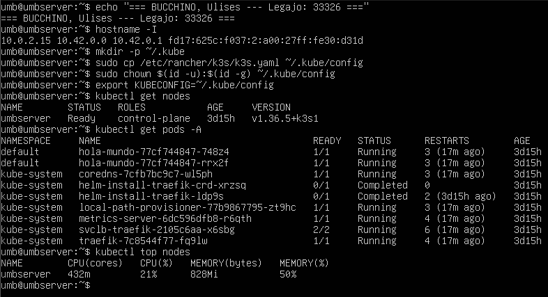

---

## Bloque A — Inspección de la red (4 preguntas de cierre)

### A1 — Los tres planos de direcciones

**Comandos ejecutados:**

```bash
echo "=== BUCCHINO, Ulises -- legajo 33326 ===" # tu firma

kubectl get nodes -o wide

# PLANO NODE: la IP de la máquina

kubectl get nodes -o jsonpath='{range .items[*]}{.metadata.name}{"\npodCIDR="}{.spec.podCIDR}{\"\n"}{end}'

kubectl get pods -A -o wide | head

# PLANO POD: 10.42.x (efímeras)

kubectl get svc -A

# PLANO SERVICE: 10.43.x (VIPs virtuales)
```

**Captura 2:** las cuatro salidas juntas, con la firma visible.

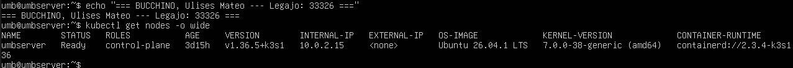

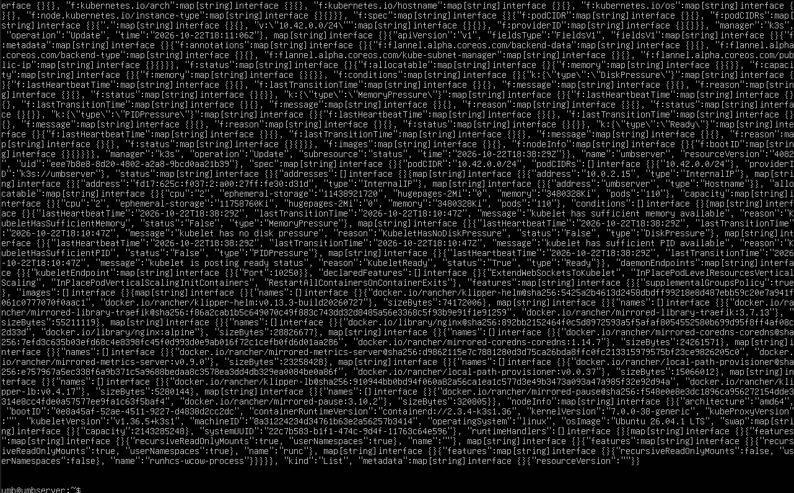

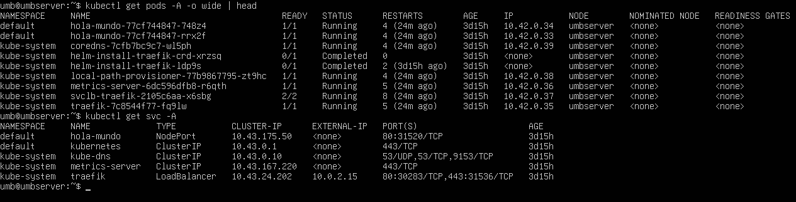

### A2 — La VIP que "no existe"

**Comandos ejecutados:**

```bash
echo "=== BUCCHINO, Ulises -- legajo 33326 ==="

kubectl get svc -n kube-system kube-dns

# ClusterIP 10.43.0.10

ping -c 2 10.43.0.10

# NO responde -- probalo y dejá la evidencia

kubectl get endpoints -n kube-system kube-dns # las IPs REALES detrás de la VIP

kubectl run dnstest --image=busybox:1.28 --restart=Never --rm -it -- \
  nslookup kube-dns.kube-system.svc.cluster.local # el DNS interno resuelve nombres
```

**Captura 3:** el ping sin respuesta + `kubectl get endpoints` (que sí muestra IPs), con la firma visible.

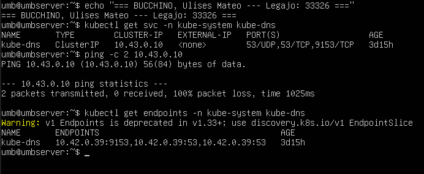

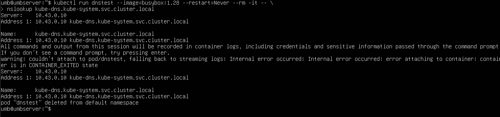


### A3 — ¿Quién conoce la ruta entre el nodo y los pods?

**Comandos ejecutados:**

```bash
echo "=== BUCCHINO, Ulises -- legajo 33326 ==="

ip -brief address

kubectl get pods -A -o wide | head

ip route | head

# la IP de TU nodo (el plano node, ej. 192.168.0.19)
# los pods en 10.42.x
# la ruta por defecto del nodo

sudo iptables -t nat -L KUBE-SERVICES -n | head # el NAT de los Services (kube-proxy)
```

**Captura 4:** IP del nodo + IPs de pods + al menos una regla KUBE-SERVICES, con la firma visible.

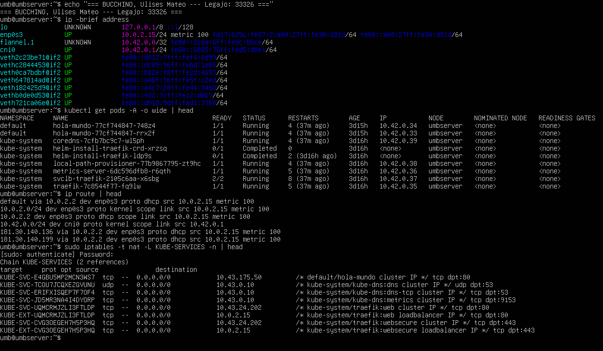

### A4 — El CNI en uso y la MTU

**Comandos ejecutados:**

```bash
echo "=== BUCCHINO, Ulises -- legajo 33326 ==="

ls /etc/cni/net.d/ 2>/dev/null

# path estándar de CNI (en K3s suele venir VACÍO)

sudo ls /var/lib/rancher/k3s/agent/etc/cni/net.d/ # el que usa K3s de verdad (flannel por defecto)

sudo cat /var/lib/rancher/k3s/agent/etc/cni/net.d/10-flannel.conflist 2>/dev/null | head -20

ip -o link show | grep -E 'cni0|flannel'

# las interfaces del overlay

ip link show flannel.1 2>/dev/null | head -1 # MTU del TÚNEL VXLAN

ip link show cni0 2>/dev/null | head -1

# MTU del bridge local (la que ven tus pods)
```

**Captura 5:** el CNI configurado + la MTU de `flannel.1` y de `cni0`, con la firma visible.

> **Nota:** flannel.1 (túnel VXLAN) muestra ~1450 y cni0 (bridge local) 1500.

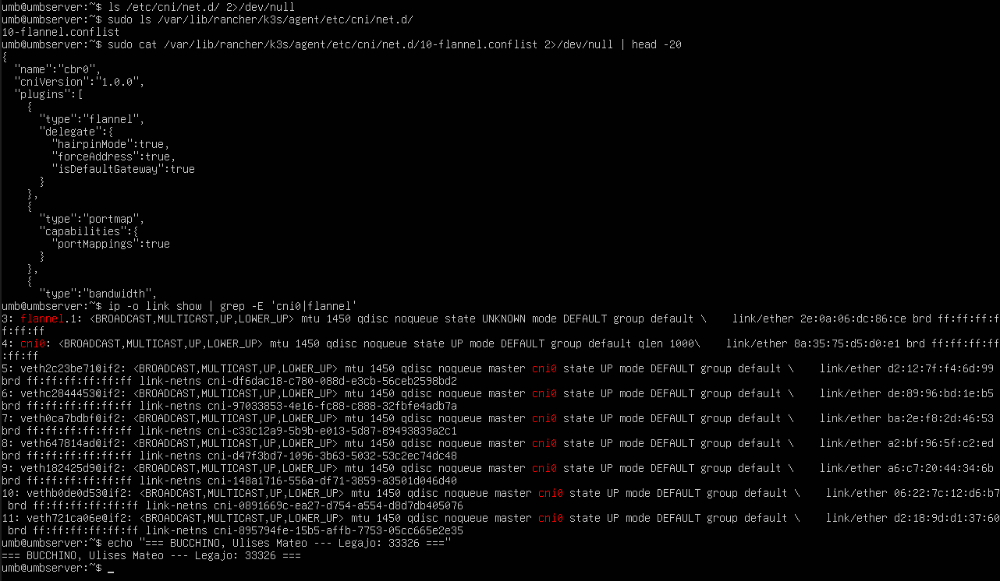

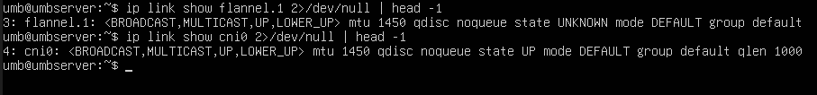

### Preguntas de cierre del Bloque A

**1. ¿Cuál es la diferencia entre la IP de un pod (10.42.x) y la de un Service (10.43.x)? ¿Por qué una responde al ping y la otra no?**

La IP de un pod (10.42.x) es una dirección real de la red overlay del CNI (flannel), asignada a una interfaz de red del contenedor; es direccionable dentro del cluster y responde al ping. La IP de un Service (10.43.x, ClusterIP) es una VIP virtual que **no está asignada a ninguna interfaz física**; es un "frontend" gestionado por kube-proxy mediante reglas de iptables/IPVS que hacen DNAT hacia los endpoints reales (los pods). Al hacer ping a la VIP no responde porque no hay una interfaz que la posea; kube-proxy solo redirige el tráfico que llega a esa VIP hacia los pods.

**2. El Service kube-dns tiene una sola VIP, pero `kubectl get endpoints` muestra varias IPs. ¿Quién convierte una en la otra?**

kube-proxy. Lee los objetos `Service` y `Endpoints` (o EndpointSlices) del API server y programa reglas de iptables/IPVS en cada nodo que traducen (DNAT) la VIP del Service a las IPs reales de los pods listados en los endpoints. Cuando un pod nace o muere, el controlador de endpoints actualiza la lista y kube-proxy reprograma las reglas automáticamente.

**3. Tu nodo tiene IP 192.168.x.x y los pods 10.42.x: ¿quién conoce la ruta entre ambos? ¿Qué pasaría si otro host del DC (fuera del cluster) quisiera llegar a un pod?**

La ruta la conoce el nodo mismo, porque el CNI (flannel) programa en la tabla de enrutamiento del nodo una ruta hacia el `podCIDR` de cada nodo a través del túnel VXLAN (interfaz `flannel.1`). Si otro host del centro de datos (fuera del cluster) quisiera llegar directamente a un pod, **no podría**, porque los pods están en una red privada overlay (10.42.x) no enrutable desde fuera del cluster. Para llegar desde fuera se necesitaría un `NodePort`, `LoadBalancer`, `Ingress`, o que el CNI hiciera peering BGP con la red del DC para anunciar las rutas de los pods.

**4. ¿Qué MTU efectiva tienen los paquetes pod-pod con flannel (tu captura 5)? ¿Qué overhead agrega la encapsulación VXLAN y qué síntoma típico produce un MTU mal ajustado?**

Con flannel VXLAN, `flannel.1` (túnel) muestra ~1450 bytes y `cni0` (bridge local) 1500 bytes. El overhead de VXLAN es de unos 50 bytes (cabecera externa Ethernet + IP + UDP + VXLAN), por eso 1500 − 50 ≈ 1450. Un MTU mal ajustado (por ejemplo, intentar enviar paquetes de 1500 por el túnel) produce paquetes fragmentados o descartados; el síntoma típico es conexiones que se cuelgan ("hang"), SSH que se corta al transferir archivos grandes, `curl` que se queda esperando, o handshakes TLS que fallan de forma intermitente.

## Bloque B — Auto-escalado con HPA

### B0 — Verificación previa

**Comandos ejecutados:**

```bash
echo "=== BUCCHINO, Ulises -- legajo 33326 ==="

kubectl get nodes

kubectl get pods -n kube-system | grep metrics-server # DEBE estar Running

kubectl top nodes

# DEBE responder con números
```

**Captura 6:** metrics-server Running + `kubectl top nodes`, con la firma visible.

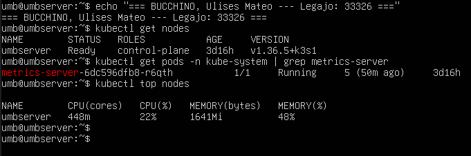

### B1 — Desplegar la app con CPU requests

**Archivo `hpa-demo.yaml` (con comentario de nombre/legajo):**

```yaml
# BUCCHINO, Ulises -- legajo 33326
apiVersion: apps/v1
kind: Deployment
metadata:
  name: web
spec:
  replicas: 1
  selector:
    matchLabels: { app: web }
  template:
    metadata:
      labels: { app: web }
    spec:
      containers:
        - name: web
          image: registry.k8s.io/hpa-example
          ports:
            - containerPort: 80
          resources:
            requests:
              cpu: 200m
---
apiVersion: v1
kind: Service
metadata:
  name: web
spec:
  selector: { app: web }
  ports:
    - port: 80
      targetPort: 80
```

**Comandos ejecutados:**

```bash
kubectl apply -f hpa-demo.yaml

kubectl get pods -o wide

kubectl get endpoints web

# DEBE mostrar la IP del pod

# Repaso: escalar A MANO (después volvemos a 1)
kubectl scale deployment web --replicas=3
kubectl get pods -l app=web
kubectl scale deployment web --replicas=1
```

> **¿Por qué `requests`?** El HPA no mide CPU absoluta: mide % respecto del request. Pod pide 200m y consume 100m → 50%. Sin request no hay denominador → no escala.

**Capturas B1:**

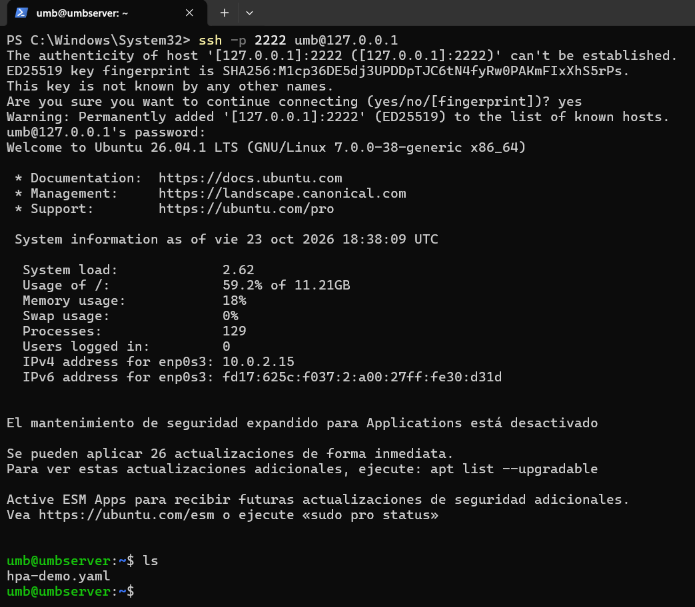

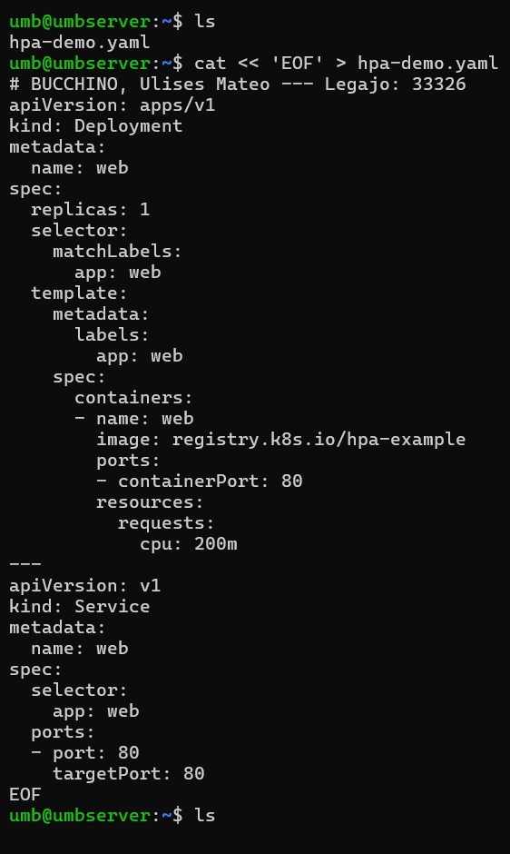

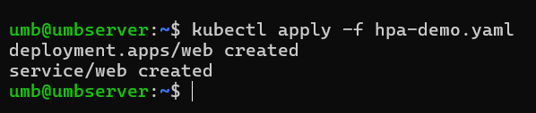

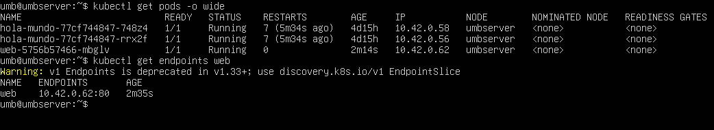

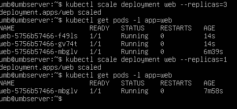

### B2 — Crear el HPA y verlo escalar

**Archivo `hpa.yaml` (con comentario de nombre/legajo):**

```yaml
# BUCCHINO, Ulises -- legajo 33326
apiVersion: autoscaling/v2
kind: HorizontalPodAutoscaler
metadata:
  name: web
spec:
  scaleTargetRef:
    apiVersion: apps/v1
    kind: Deployment
    name: web
  minReplicas: 1
  maxReplicas: 5
  metrics:
    - type: Resource
      resource:
        name: cpu
      target:
        type: Utilization
        averageUtilization: 50 # objetivo: CPU promedio en 50% del request
```

**Comandos ejecutados:**

```bash
kubectl apply -f hpa.yaml
kubectl get hpa
```

**Captura 7 — HPA en reposo:** `kubectl get hpa` con TARGETS en `0%/50%` (tarda ~30–60 s en mostrar el %; si dice `<unknown>`, esperar).

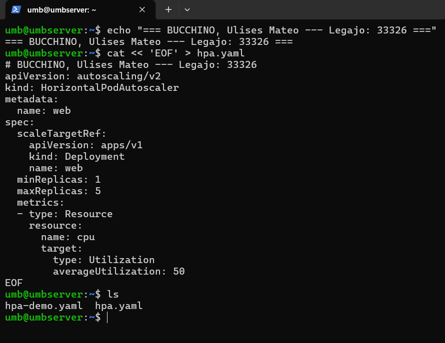

**Lanzar la carga dentro del cluster:**

```bash
kubectl run load-generator --image=busybox:1.28 --restart=Never -- \
  /bin/sh -c "while true; do wget -q -O- http://web; done"
```

**Mirar el HPA trabajar:**

```bash
for i in 1 2 3 4 5 6; do sleep 30; kubectl get hpa; echo "pods: $(kubectl get pods -l app=web --no-headers | wc -l)"; done
```

**Captura 8 — HPA bajo carga:** `kubectl get hpa` con el % alto y REPLICAS > 1 (en cluster de referencia llegó a 381%/50% y escaló 1 → 5).

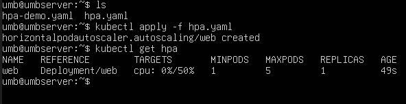

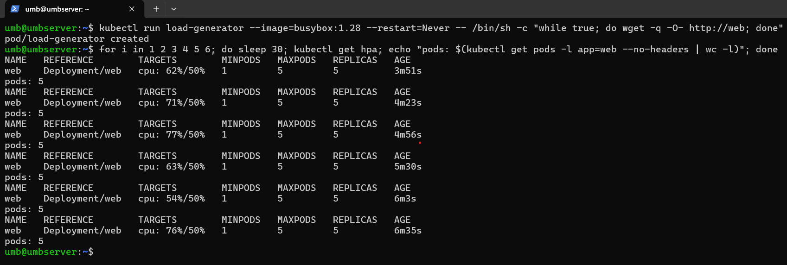

```bash
kubectl describe hpa web # sección "Events": "New size: 5; reason: cpu utilization above target"
kubectl top pods -l app=web
```

**Captura 9:** `kubectl describe hpa web` con el evento de escalado a la vista.

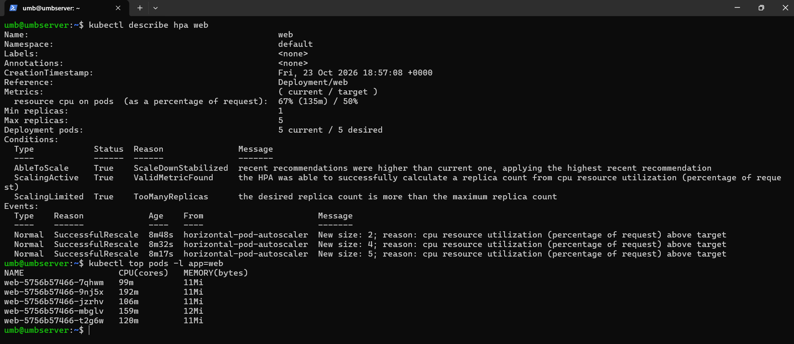

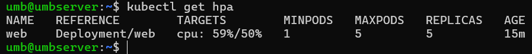

> Eso es auto-escalado. Nadie tocó replicas: K8s leyó la métrica, la comparó con el objetivo (50%) y agregó pods solo hasta el techo. El mismo reconciliation loop de la asincrónica del 15/10, ahora alimentado por métricas.

### B3 — Bajar la carga y ver el scale-down

**Comandos ejecutados:**

```bash
kubectl delete pod load-generator

kubectl get hpa -w

# (Ctrl+C para salir)
# esperar ~5 min: REPLICAS baja de 5 → 1
```

**Captura 10:** `kubectl get hpa` después de la ventana de estabilización, con REPLICAS bajando o ya en 1. Paciencia: la ventana por defecto es de 5 minutos — no es un error.

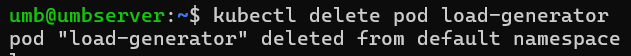

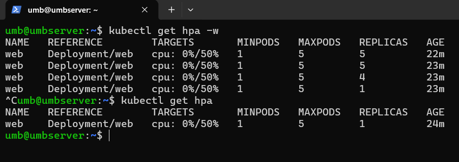

> **Sube rápido, baja lento:** escalar hacia arriba es urgencia; hacia abajo es prudencia. Es el mismo criterio que un termostato que no apaga la caldera al primer grado de más.

### Preguntas de cierre del Bloque B

**5. ¿Por qué el HPA necesita que el Deployment tenga `resources.requests.cpu`?**

Porque el HPA no mide el consumo absoluto de CPU, sino el **porcentaje de utilización respecto del request** (`utilización = uso actual / request`). Sin `requests.cpu` no hay denominador, no puede calcular el % y el HPA queda en `<unknown>`, por lo tanto no puede decidir escalar.

**6. Si ponés `maxReplicas: 5` y la carga sigue subiendo, ¿qué pasa? ¿Por qué no escala más?**

Se queda en `maxReplicas` (5). No escala más porque `maxReplicas` es el techo configurado: el HPA respeta ese límite superior aunque la métrica siga por encima del objetivo (50%). La aplicación ya no recibirá más réplicas aunque siga saturada.

**7. ¿Por qué el scale-down tarda minutos y el scale-up no?**

El scale-up es urgente: hay que agregar capacidad rápido para evitar que la aplicación se sature y falle. El scale-down es prudente: Kubernetes aplica una **ventana de estabilización** (por defecto ~3–5 minutos) antes de reducir réplicas, para asegurarse de que la bajada de carga es real y no un pico transitorio. Así se evita el "thrashing" o efecto ping-pong de subir y bajar réplicas constantemente (como un termostato que no apaga la caldera al primer grado de menos).

## Cierre integrador — 2 preguntas finales

**8. El HPA crea pods nuevos cuando sube la carga. Volvé a la captura 2 (A2): esos pods nuevos reciben IP del rango 10.42.x y hay que poder llegar a ellos desde el Service. ¿Qué componente del cluster se actualiza solo cuando nacen o mueren pods? ¿Y relacionado: ¿qué problema de planificación de direcciones del DC se agranda cuando el número de pods cambia todo el tiempo?**

El componente que se actualiza solo es el **EndpointSlice/Endpoints** (gestionado por el controlador de endpoints de Kubernetes), y a partir de eso **kube-proxy** reprograma sus reglas de iptables/IPVS para que la VIP del Service siga apuntando a los pods actuales. El problema del DC que se agranda es la **explosión de la tabla de enrutamiento**: si cada host del centro de datos tuviera que aprender una ruta individual hacia cada pod (que cambian constantemente), las tablas de enrutamiento crecerían sin escalar. Por eso se usa una red overlay (VXLAN/BGP) que concentra las rutas y evita que cada host del DC conozca cada IP de pod.

**9. ¿Cuál es la diferencia entre lo que decidís vos con `kubectl scale` y lo que decide el HPA? ¿En los dos casos, quién "sostiene" esa intención?**

`kubectl scale` es una decisión **manual y puntual** del operador que fija un número de réplicas en ese momento; el HPA es un **controlador automático y continuo** que ajusta las réplicas según la métrica observada (CPU) respecto del objetivo. En ambos casos, quien "sostiene" la intención es el **Deployment** (su campo `spec.replicas` es la fuente de verdad del estado deseado), y el **ReplicaSet** es el responsable de materializarlo creando o borrando pods hasta alcanzar ese número.

## Preguntas del video — "K3s, el Kubernetes más simple"

**1. El video muestra lo simple que es instalar K3s. ¿Qué se esconde detrás de esa simplicidad — qué componentes del Kubernetes "completo" empaqueta K3s en un solo binario?**

K3s elimina los proveedores de nube (cloud providers) y componentes legacy, y empaqueta en un único binario ligero (<100 MB): API server, scheduler, controller-manager, kubelet, kube-proxy, containerd (runtime de contenedores), CNI (flannel por defecto), CoreDNS (DNS), Traefik (ingress/controller) y etcd (almacenamiento). Todo eso lo hace instalable con un solo comando (`curl -sfL https://get.k3s.io | sh -`).

**2. ¿Por qué esa simplicidad lo hace ideal para edge/laboratorios y no te haría descartarlo para aprender los internals de K8s?**

Es ideal para edge/labs por ser ligero, de bajo consumo de recursos, rápido de instalar y con menor superficie de ataque. No hay que descartarlo para aprender internals porque conserva los mismos componentes estándar de Kubernetes (API server, etcd, kubelet, kube-proxy, CNI, Services, Deployments, HPA, etc.), por lo que los conceptos, objetos y el bucle de reconciliación son idénticos a los de Kubernetes "completo".

---

*Trabajo realizado sobre K3s en el servidor `umbserver`, alumno Ulises Mateo Bucchino (legajo 33326).*