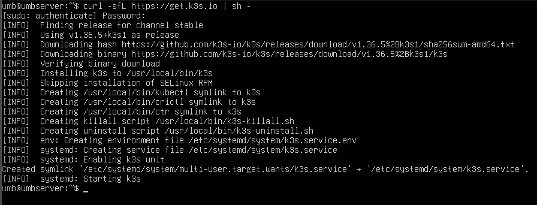
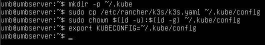
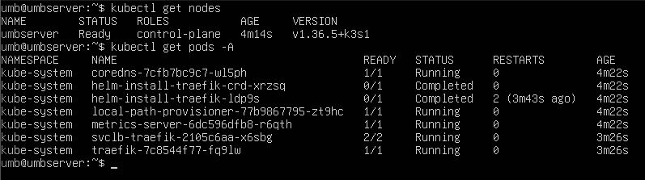
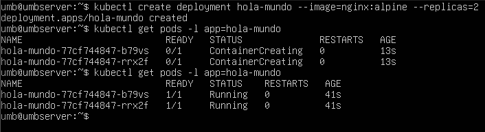
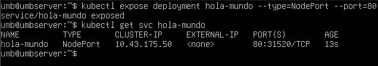
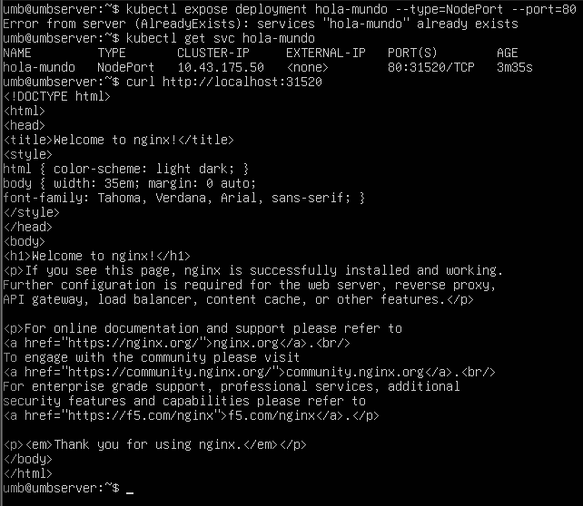
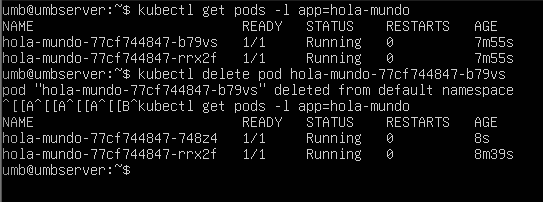

# Práctica: Kubernetes (K3s) en modo Single-Node

> **Asignatura:** Gestión Operativa y Seguridad en Redes  
> **Alumno:** Ulises Mateo Bucchino  
> **Tema:** Orquestación de contenedores con K3s  
> **Entorno:** Servidor Ubuntu (`umbserver`) — clúster single-node  

---

## 1. Índice

1. [Objetivo de la práctica](#2-objetivo-de-la-práctica)
2. [Objetivos de aprendizaje](#3-objetivos-de-aprendizaje)
3. [Prerequisitos](#4-prerequisitos)
4. [Arquitectura del laboratorio](#5-arquitectura-del-laboratorio)
5. [Paso 1 — Instalación de K3s](#6-paso-1--instalación-de-k3s)
6. [Paso 2 — Configuración de permisos de kubectl](#7-paso-2--configuración-de-permisos-de-kubectl)
7. [Paso 3 — Verificación del estado del clúster](#8-paso-3--verificación-del-estado-del-clúster)
8. [Paso 4 — Despliegue de la aplicación y resiliencia](#9-paso-4--despliegue-de-la-aplicación-y-resiliencia)
9. [Paso 5 — Exponer la aplicación con NodePort](#10-paso-5--exponer-la-aplicación-con-nodeport)
10. [Paso 6 — Obtener el puerto y probar la conectividad](#11-paso-6--obtener-el-puerto-y-probar-la-conectividad)
11. [Paso 7 — Prueba de reconciliación (self-healing)](#12-paso-7--prueba-de-reconciliación-self-healing)
12. [Limpieza del entorno](#13-limpieza-del-entorno)
13. [Troubleshooting y notas](#14-troubleshooting-y-notas)
14. [Conclusiones](#15-conclusiones)

---

## 2. Objetivo de la práctica

Instalar y configurar un clúster **Kubernetes single-node** utilizando **K3s** (distribución ligera de Kubernetes creada por Rancher/SUSE), desplegar una aplicación web de demostración (nginx), exponerla al exterior mediante un servicio `NodePort` y verificar los mecanismos nativos de resiliencia y reconciliación del clúster.

K3s empaqueta Kubernetes en un único binario de menos de 100 MB, pensado para entornos con recursos limitados (IoT, edge, laboratorios, VMs), por lo que resulta ideal para practicar en una sola máquina virtual.

## 3. Objetivos de aprendizaje

- Instalar K3s con el script oficial y comprender qué componentes instala (API server, kubelet, containerd, Traefik, coredns, etc.).
- Configurar `kubectl` para comunicarse con el API server del clúster.
- Verificar el estado del clúster: nodos y pods del namespace `kube-system`.
- Crear un `Deployment` con réplicas y observar el ciclo de vida de los pods.
- Exponer una aplicación con un servicio `NodePort`.
- Probar la conectividad con `curl`.
- Comprobar la **reconciliación** de Kubernetes: borrar un pod y ver cómo el `ReplicaSet` lo recrea automáticamente.

## 4. Prerequisitos

- Un servidor (físico o VM) con **Ubuntu Server** (o cualquier distribución compatible con systemd) accesible por SSH.
- Usuario con privilegios `sudo`.
- Conexión a Internet para descargar el binario de K3s e imágenes de contenedores.
- Puerto **6443** (API server) y **8472/UDP** (VXLAN de Flannel, si se agregan nodos) abiertos en el cortafuegos si aplica.
- Conocimientos básicos de línea de comandos Linux.

> **Nota:** En esta práctica el nodo se llama `umbserver` y el usuario es `umb`.

## 5. Arquitectura del laboratorio

```
                     ┌──────────────────────────────────────────┐
                     │              umbserver (VM)              │
                     │        Kubernetes single-node            │
                     │                                          │
   usuario ──curl──▶ │  NodePort 31520 ──▶ Traefik/iptables    │
   localhost:31520   │        │                                 │
                     │        ▼                                 │
                     │  ┌─────────────────────────────────┐    │
                     │  │  Deployment: hola-mundo          │    │
                     │  │  Imagen: nginx:alpine            │    │
                     │  │  réplicas: 2                     │    │
                     │  │   ├── Pod (...-b79vs)  Running   │    │
                     │  │   └── Pod (...-rrx2f)  Running   │    │
                     │  └─────────────────────────────────┘    │
                     │                                          │
                     │  Componentes del sistema:                │
                     │   • k3s (control-plane + worker)         │
                     │   • containerd (runtime)                 │
                     │   • kubelet / kube-proxy                 │
                     │   • CoreDNS                              │
                     │   • Traefik (ingress controller)         │
                     │   • metrics-server                       │
                     │   • local-path-provisioner (StorageClass)│
                     └──────────────────────────────────────────┘
```

En un clúster **single-node**, el mismo nodo actúa simultáneamente como **master (control-plane)** y como **worker**. Esto simplifica el laboratorio, pero no refleja un entorno de producción (no hay alta disponibilidad ni tolerancia a fallos de nodo).

## 6. Paso 1 — Instalación de K3s

### 6.1. Comando

```bash
curl -sfL https://get.k3s.io | sh -
```

Este es el **script oficial de instalación** de K3s. Descarga el binario estable más reciente, lo instala en `/usr/local/bin/k3s` y lo registra como servicio de `systemd` que arranca automáticamente con el servidor.

### 6.2. Salida observada



Resumen de lo que reporta el instalador:

| Mensaje | Significado |
|---|---|
| `Finding release for channel stable` | Se usa el canal de release **stable**. |
| `Using v1.36.5+k3s1 as release` | Versión de Kubernetes instalada. |
| `Downloading hash .../sha256sum-amd64.txt` | Verificación de integridad del binario. |
| `Downloading binary .../k3s` | Descarga del binario único de K3s. |
| `Verifying binary download` | Comprobación del hash SHA-256. |
| `Installing k3s to /usr/local/bin/k3s` | Instalación del binario. |
| `Creating /usr/local/bin/kubectl symlink to k3s` | `kubectl` se resuelve al binario de K3s. |
| `Creating /usr/local/bin/crictl symlink to k3s` | Herramienta de diagnóstico de contenedores. |
| `Creating /usr/local/bin/ctr symlink to k3s` | Cliente del runtime containerd. |
| `Creating killall script /usr/local/bin/k3s-killall.sh` | Script para detener todos los procesos de K3s. |
| `Creating uninstall script /usr/local/bin/k3s-uninstall.sh` | Script de desinstalación completa. |
| `Creating environment file /etc/systemd/system/k3s.service.env` | Variables de entorno del servidor. |
| `Creating service file /etc/systemd/system/k3s.service` | Unidad de systemd. |
| `Enabling k3s unit` / `Starting k3s` | Servicio habilitado e iniciado. |

### 6.3. Notas

- El instalador pide la contraseña de `sudo` (`[sudo] password for umb:`) porque necesita escribir en `/usr/local/bin` y crear el servicio systemd.
- **K3s no requiere** instalar por separado Docker, kubelet, kubeadm ni CNI: todo viene embebido (containerd como runtime y Flannel como CNI por defecto).

## 7. Paso 2 — Configuración de permisos de kubectl

K3s guarda el kubeconfig (credenciales y endpoint del API server) en `/etc/rancher/k3s/k3s.yaml`, con permisos de root. Para usar `kubectl` como usuario normal hay que copiarlo al directorio `~/.kube`.

### 7.1. Comandos

```bash
mkdir -p ~/.kube
sudo cp /etc/rancher/k3s/k3s.yaml ~/.kube/config
sudo chown $(id -u):$(id -g) ~/.kube/config
export KUBECONFIG=~/.kube/config
```



### 7.2. Explicación de cada comando

| Comando | Propósito |
|---|---|
| `mkdir -p ~/.kube` | Crea el directorio estándar de configuración de kubectl (`-p` evita el error si ya existe). |
| `sudo cp /etc/rancher/k3s/k3s.yaml ~/.kube/config` | Copia el kubeconfig generado por K3s (contiene el token y el endpoint `https://127.0.0.1:6443`). |
| `sudo chown $(id -u):$(id -g) ~/.kube/config` | Transfiere la propiedad del archivo al usuario actual para que kubectl pueda leerlo sin `sudo`. |
| `export KUBECONFIG=~/.kube/config` | Indica a kubectl qué kubeconfig usar en la sesión actual. |

### 7.3. Persistencia (opcional)

El `export` solo dura mientras viva la sesión SSH. Para hacerlo permanente:

```bash
echo 'export KUBECONFIG=~/.kube/config' >> ~/.bashrc
source ~/.bashrc
```

## 8. Paso 3 — Verificación del estado del clúster

### 8.1. Listar nodos

```bash
kubectl get nodes
```

```
NAME         STATUS   ROLES              AGE   VERSION
umbserver    Ready    control-plane      4m14s v1.36.5+k3s1
```

- `STATUS: Ready` → el nodo está sano y registrado (`Ready=True` significa que el kubelet reporta capacidad disponible).
- `ROLES: control-plane` → el nodo ejecuta los componentes de gestión (API server, scheduler, controller-manager).
- `VERSION` → coincide con la versión de K3s instalada.

### 8.2. Listar pods de todo el clúster

```bash
kubectl get pods -A
```



```
NAMESPACE     NAME                                      READY   STATUS      RESTARTS   AGE
kube-system   coredns-7cfb7bc9c7-w15ph                  1/1     Running     0          4m22s
kube-system   helm-install-traefik-crd-xrzsq            0/1     Completed   0          4m22s
kube-system   helm-install-traefik-1dp9s                0/1     Completed   2 (3m43s ago) 4m22s
kube-system   local-path-provisioner-77b9867795-zt9hc   1/1     Running     0          4m22s
kube-system   metrics-server-6cd596dfb8-r6qth           1/1     Running     0          4m22s
kube-system   svclb-traefik-2105c6aa-x65bg              2/2     Running     0          3m26s
kube-system   traefik-7c8544f77-fq91w                   1/1     Running     0          3m26s
```

### 8.3. Interpretación de los pods del namespace `kube-system`

| Pod | Función |
|---|---|
| `coredns` | Servidor DNS interno del clúster: resuelve nombres como `servicio.namespace.svc.cluster.local`. |
| `helm-install-traefik-crd` / `helm-install-traefik` | Jobs de Helm que instalan Traefik y sus CRDs. Su estado `Completed` es normal: son jobs, no pods permanentes. |
| `local-path-provisioner` | Proveedor de almacenamiento local que permite crear PVs dinámicos (StorageClass `standard`). |
| `metrics-server` | Recolecta métricas de CPU/memoria del nodo y pods (requerido por `kubectl top`). |
| `svclb-traefik` | DaemonSet que crea un "load balancer" de usuario para el servicio de Traefik en cada nodo. |
| `traefik` | Ingress controller incluido por defecto en K3s. |

> Todos los pods `Running` con `1/1` (o `2/2` en el caso de `svclb-traefik`) indican un clúster **sano y operativo**.

## 9. Paso 4 — Despliegue de la aplicación y resiliencia

### 9.1. Crear el Deployment

```bash
kubectl create deployment hola-mundo --image=nginx:alpine --replicas=2
```

```
deployment.apps/hola-mundo created
```

Kubernetes crea automáticamente un `ReplicaSet` que mantiene **2 réplicas** del pod con la imagen `nginx:alpine`. El `ReplicaSet` hereda el label `app=hola-mundo`, lo que permite filtrar los pods con `-l app=hola-mundo`.

### 9.2. Verificar los pods (fase de creación)

```bash
kubectl get pods -l app=hola-mundo
```

```
NAME                              READY   STATUS              RESTARTS   AGE
hola-mundo-77cf744847-b79vs       0/1     ContainerCreating   0          13s
hola-mundo-77cf744847-rrx2f       0/1     ContainerCreating   0          13s
```

`ContainerCreating` significa que el kubelet está descargando la imagen y montando el pod (red CNI, volúmenes, etc.).

### 9.3. Verificar los pods (fase estable)

```bash
kubectl get pods -l app=hola-mundo
```



```
NAME                              READY   STATUS    RESTARTS   AGE
hola-mundo-77cf744847-b79vs       1/1     Running   0          41s
hola-mundo-77cf744847-rrx2f       1/1     Running   0          41s
```

Ambos pods están `Running` con `1/1` contenedores listos. El despliegue con **2 réplicas** ya garantiza tolerancia a la pérdida de un pod (la prueba se realiza en el Paso 7).

## 10. Paso 5 — Exponer la aplicación con NodePort

### 10.1. Crear el servicio

```bash
kubectl expose deployment hola-mundo --type=NodePort --port=80
```

```
service/hola-mundo exposed
```

### 10.2. Inspeccionar el servicio

```bash
kubectl get svc hola-mundo
```



```
NAME          TYPE        CLUSTER-IP     EXTERNAL-IP   PORT(S)        AGE
hola-mundo    NodePort    10.43.175.50   <none>        80:31520/TCP   13s
```

### 10.3. Interpretación

| Campo | Valor | Significado |
|---|---|---|
| `TYPE` | `NodePort` | Expone el servicio en un puerto fijo de **todos** los nodos del clúster. |
| `CLUSTER-IP` | `10.43.175.50` | IP virtual interna (Service ClusterIP; rango por defecto de K3s: `10.43.0.0/16`), accesible solo desde dentro del clúster. |
| `EXTERNAL-IP` | `<none>` | No hay cloud provider; la exposición externa se hace vía NodePort. |
| `PORT(S)` | `80:31520/TCP` | El servicio escucha en el puerto **80** dentro del clúster y lo redirige al puerto **31520** en cada nodo (rango NodePort por defecto: 30000–32767). |

## 11. Paso 6 — Obtener el puerto y probar la conectividad

### 11.1. Comportamiento ante un `expose` repetido

Si se vuelve a ejecutar el `expose` anterior, Kubernetes responde con un error porque el servicio ya existe:

```
Error from server (AlreadyExists): services "hola-mundo" already exists
```

Esto **no es un fallo**: los recursos de Kubernetes son *declarativos e idempotentes*. Para modificar el servicio existente se usaría `kubectl edit svc hola-mundo` o `kubectl apply` con un manifiesto YAML.

### 11.2. Prueba con curl

Con el puerto NodePort obtenido en el paso anterior (`31520`):

```bash
curl http://localhost:31520
```



Respuesta HTTP 200 con el HTML por defecto de nginx:

```html
<!DOCTYPE html>
<html>
<head>
<title>Welcome to nginx!</title>
...
<h1>Welcome to nginx!</h1>
<p><em>Thank you for using nginx.</em></p>
</body>
</html>
```

La aplicación está **expuesta y accesible**. Si el servidor tuviera una IP de red accesible desde otros equipos, también se podría probar desde fuera con `curl http://<IP-del-nodo>:31520`.

## 12. Paso 7 — Prueba de reconciliación (self-healing)

Uno de los principios fundamentales de Kubernetes es el **bucle de reconciliación**: el estado *deseado* (declarado en el Deployment/ReplicaSet) se compara continuamente con el estado *observado* y se actúa para converger.

### 12.1. Borrar un pod manualmente

```bash
kubectl delete pod hola-mundo-77cf744847-b79vs
```

```
pod "hola-mundo-77cf744847-b79vs" deleted
```

### 12.2. Ver cómo el ReplicaSet recrea el pod

```bash
kubectl get pods -l app=hola-mundo
```



```
NAME                              READY   STATUS    RESTARTS   AGE
hola-mundo-77cf744847-48z4        1/1     Running   0          8s
hola-mundo-77cf744847-rrx2f       1/1     Running   0          7m55s
```

### 12.3. Interpretación

- El pod `...-b79vs` fue eliminado.
- El `ReplicaSet` detectó que solo había **1 pod** cuando el estado deseado eran **2**, y creó automáticamente un pod nuevo: `...-48z4`.
- Observa que el **sufijo del pod cambió** (`b79vs` → `48z4`): los pods son **efímeros e inmutables**; nunca se "reparan", se **reemplazan**.
- El otro pod (`...-rrx2f`) no se vio afectado: su `AGE` (7m55s) demuestra que siguió vivo todo el rato.

Este es el mecanismo de **auto-sanación (self-healing)** que utiliza Kubernetes en producción: si un pod muere por crash, actualización o acción manual, el controlador lo repone.

## 13. Limpieza del entorno

### 13.1. Eliminar los recursos de la práctica

```bash
kubectl delete deployment hola-mundo
kubectl delete service hola-mundo
```

Verificar:

```bash
kubectl get deployments
kubectl get svc
```

### 13.2. Desinstalar K3s por completo (opcional)

```bash
/usr/local/bin/k3s-uninstall.sh
```

Este script detiene el servicio, elimina el binario, los symlinks, `/etc/rancher/k3s` y `/var/lib/rancher/k3s`.

## 14. Troubleshooting y notas

| Situación | Solución |
|---|---|
| `kubectl` responde `Unable to connect to the server: x509` o pide credenciales | Verificar que existe `~/.kube/config` y que `KUBECONFIG` apunta a él (`export KUBECONFIG=~/.kube/config`). |
| El `export KUBECONFIG` "se pierde" al cerrar sesión | Agregarlo a `~/.bashrc` (ver sección 7.3). |
| `Error from server (AlreadyExists): services "hola-mundo" already exists` | El servicio ya fue creado; usar `kubectl get svc` para inspeccionarlo o `kubectl apply` para declarar cambios. No es un error del laboratorio. |
| El puerto NodePort (`31520`) cambia al repetir la práctica | Kubernetes asigna puertos NodePort **aleatorios** dentro del rango 30000–32767. Siempre verificar con `kubectl get svc <nombre>`. |
| Pods en `ContainerCreating` indefinidamente | Falta conectividad a Internet para descargar la imagen, o el CNI no está sano. Revisar `kubectl get pods -n kube-system` y `kubectl describe pod <pod>`. |
| `curl` a `localhost:31520` falla | Confirmar con `kubectl get svc` que el puerto es efectivamente el esperado y que el pod está `Running`. |
| `helm-install-traefik` en estado `Completed` | Es **normal**: es un Job de Helm, no un pod permanente. |

## 15. Conclusiones

- **K3s permite montar un clúster Kubernetes completo en minutos** con un único comando, sin instalar dependencias adicionales (containerd, CNI, CoreDNS, Traefik vienen incluidos).
- En un clúster **single-node**, el nodo es simultáneamente control-plane y worker; es suficiente para aprender, pero no ofrece alta disponibilidad.
- El modelo **declarativo** de Kubernetes garantiza la idempotencia: repetir comandos como `expose` devuelve `AlreadyExists` en lugar de duplicar recursos.
- Los **servicios NodePort** exponen aplicaciones en un rango de puertos predefinido (30000–32767) accesible desde el nodo y, si hay ruta de red, desde el exterior.
- Se comprobó el **bucle de reconciliación**: al borrar un pod, el `ReplicaSet` del `Deployment` lo reemplazó automáticamente, demostrando la capacidad de auto-sanación de Kubernetes.
- Los pods son **efímeros**: sus identificadores cambian al recrearse; el identificador estable a nivel de aplicación es el del `Deployment`/`Service`, no el del pod.

---

*Práctica realizada sobre K3s v1.36.5+k3s1 en el servidor `umbserver`.*


